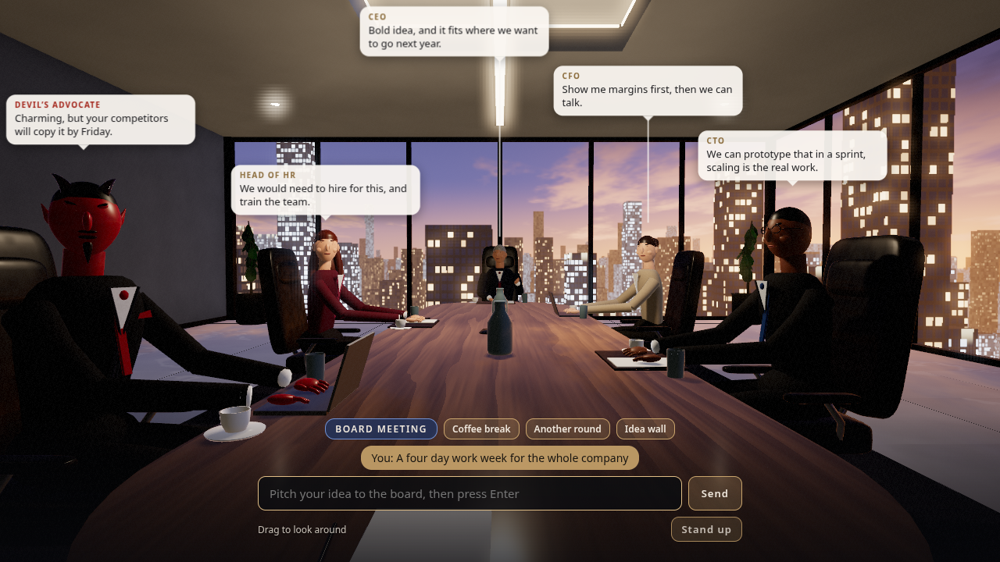

# Executive Board

Five people in a board meeting, high above a city at blue hour. Everything you see is generated from math at load
time and in the shaders. There are no images, no models and no libraries, just one HTML file with hand-written WebGPU.

Walk in, take the empty chair at the end of the table and pitch an idea. The CEO, CFO, CTO, Head of HR and a
red-skinned Devil's Advocate answer one after another in speech bubbles. Their replies come from free AI models on
OpenRouter.



## Run it
Open `index.html` in a recent **Chrome or Edge** (WebGPU required). Some browsers block WebGPU on `file://`, so if
nothing happens, serve the folder: `python3 -m http.server`, then open http://localhost:8000/.
Click **Enter the boardroom**.

**For the AI voices**, deploy the Worker in `worker/` (see `worker/README.md`). All of these are **required**:
1. Deploy it: `npx wrangler deploy`, or upload it in the dashboard.
2. Add the secret: `npx wrangler secret put OPENROUTER_API_KEY1`.
3. Set `ALLOWED_ORIGIN` to your GitHub Pages origin, e.g. `https://<user>.github.io`. The Worker fails closed: with no
   `ALLOWED_ORIGIN`, every request gets a 403.
4. Add a Cloudflare rate-limit (WAF) rule of about 30 POST requests a minute per IP.
5. Set a spend cap on the OpenRouter key. `Origin` can be faked outside a browser, so the rate limit and the cap
   are what bound the cost.
6. Paste the Worker URL into `WORKER_URL` near the top of `index.html` and into the Content-Security-Policy's
   `connect-src`. This copy already points at `https://frosty-cherry-5715.tuomashiljanen.workers.dev`.

#### Setting `ALLOWED_ORIGIN` (required)
In the Cloudflare dashboard:
1. Open **Workers & Pages** and click your Worker.
2. Open **Settings**, then **Variables and Secrets**, then click **Add**.
3. Choose type **Text**. The name is `ALLOWED_ORIGIN`.
4. The value is your site's exact origin: the scheme and host only, with no path and no trailing slash, e.g.
   `https://name.github.io`. For a project site at `https://name.github.io/repo/`, the origin is still
   `https://name.github.io`. To allow several, separate them with commas:
   `https://name.github.io,http://localhost:8000`.
5. Click **Deploy** (or **Save and deploy**).

Or, with wrangler, put it in `wrangler.toml` and run `npx wrangler deploy`:
```toml
[vars]
ALLOWED_ORIGIN = "https://name.github.io"
```

Good to know:
- **Fail closed:** until `ALLOWED_ORIGIN` is set, the Worker answers 403 to everything, and the board shows
  "The Worker refused this page. Check ALLOWED_ORIGIN."
- **Exact match:** `https://name.github.io/` (with a slash), `http://` instead of `https`, or another subdomain
  are all different origins and get a 403.
- **Local testing:** a page opened as `file://` has no origin (the browser sends `null`), so it can never go
  through the Worker. Use `index.html?mock` for canned replies. Or serve the folder
  (`python3 -m http.server 8000`, then open http://localhost:8000/) and temporarily add `http://localhost:8000` to
  the list. Remove it again when you are done.

The key lives only in the Worker secret, never in the page or the repo. Without a Worker, everything else works,
and `?mock` gives canned replies.

| Control | Action |
|---|---|
| Mouse | Look around (pointer lock while walking; drag while seated) |
| `W` `A` `S` `D` | Walk (at standing eye height, 1.65 m; you can't walk through the table, chairs, plants, credenza or walls) |
| `Shift` | Walk faster |
| `F` | Sit in the empty chair, or start a 1-on-1 with the board member you walked up to (the nearest wins) |
| `M` | Music on / off (while walking) |
| `E` | Open / close the idea wall's readable list while walking (a hint shows when you walk up to the wall) |
| `Esc` | Back to the title / close the list |
| `I` | Frame counter (developer readout) |

**Once seated there are no keyboard shortcuts.** Everything is a button on the chat bar: **Send** (or Enter inside the
idea box), **Coffee break / Back to business**, **Another round**, **Idea wall** (its list has a **Close** button)
and **Stand up**. Drag with the mouse to look around. Typing in the idea box never triggers anything; letters like
C, R, E or F are just text there.

**1-on-1.** Walk up to any board member: within about 1.3 m, roughly facing them. A hint reads "Press F to talk
with CFO", and a **Talk to CFO** button appears on desktop and touch alike. With a locked mouse, a click also works.
- The camera glides to a spot about 1 m away, slightly crouched to their eye level. The spot goes through the same
  collision as walking, so it never lands in a chair.
- That member turns to you. The others carry on and glance over now and then.
- The chat bar works as when seated, but only that member answers. It has just **Send** (or Enter in the box) and
  **Leave**, with no keys.
- **Leave** glides you back to where you stood. It drops any reply still on its way: the round token goes stale and
  the request is aborted.
- The member speaks in their own persona (the coffee one during a break), framed as a private, one-to-one chat.
- Each member keeps a private transcript of your talks, capped at about 2000 characters and sent as user-role
  context. It stays separate from the board's shared transcript and never reaches the idea wall or the other members.
- A board round cannot start while a 1-on-1 is open, and you cannot open one while a round runs. Coffee break and
  Another round are locked meanwhile.
- All the usual AI safety rules apply: delimited and defused user text, the 300-character cap, the send lock,
  model fallbacks, stopping on 401/402, timeouts, ~100-character plain replies and `textContent` bubbles.

**Music.** Calm lounge jazz plays in a loop, written and synthesised in code with Web Audio; there are no audio files.
- Instruments: an electric piano comping a slow 16-bar progression in F, plus a walking upright bass, brushes and a
  ride, all swung at 86 BPM. A sparse melody line is improvised from a seeded random walk over chord and scale tones.
- It starts on your first click, tap or key press (browsers need one), at volume 0.25.
- The control in the top-right corner is a mute button and a volume slider (44 px on touch); `M` toggles mute while
  walking. Both settings are remembered in `localStorage`, validated on load.
- The loop is 16 bars, about 44.7 s at 86 BPM, and it runs on without a seam: no gap, click or restart.
- Muting or hiding the tab fades out over 30 ms. Coming back fades in over 0.3 s. Volume moves ramp over 30 ms.
- The music pauses while the tab is hidden. It dips a little during a coffee break and more in a 1-on-1.
- Phones get fewer voices: no melody line, three-note chords and a shorter reverb.

**On a phone or tablet** (any coarse pointer; add `?touch` to force this on a desktop):
- A joystick bottom-left walks: there is a small dead zone, the push is capped at full speed, and collisions still
  apply. Drag anywhere else on the scene to look around. The two use separate fingers, so you can walk and turn at
  once. Lifting, cancelling or losing a finger always lets go.
- Big buttons (at least 44 px): **Sit** shows near the empty chair, **Talk to …** near a board member, **Idea wall**
  opens the list, and the music button and slider sit top right. In a 1-on-1 the bar has Send and Leave, and the
  joystick hides. While seated, the
  chat bar has Send, Stand up, Coffee break, Another round and Idea wall. **Views** cycles the developer views
  (`?dev` only).
- There is no pointer lock. Only the scene and the joystick swallow gestures, so the chat box and the idea list still
  scroll and select. The chat box uses a 16 px font so iOS does not zoom in, and the bar moves up above the
  on-screen keyboard while the 3D view keeps its size.
- Layout fits portrait and landscape phones and keeps clear of notches and home bars (safe-area insets). Bubbles are
  smaller (at most 160 px), and the idea list fills the screen.
- Narrow screens keep the desktop's ~88° horizontal view; the vertical view widens instead, up to ~128°. Below a 0.85
  width-to-height ratio, the seat also leans back 0.55 m and up 0.08 m, tilted slightly down. Your own chair's back
  is not drawn from there, though it still casts its shadow. All five members and all five bubbles fit on a
  390×844 portrait phone.
- A bubble whose speaker is off-screen or behind you is never dropped. It docks at that side's edge, with an arrow
  pointing toward the speaker.
- Phones start on the **low** quality tier.

**Quality.** The title screen has an Auto / High / Low picker (it reloads with `?detail=auto|high|low`; any other
value counts as auto). Auto picks low on touch devices and small screens, high elsewhere. Press `I` for frame rate,
frame time, render size, the current resolution scale and the tier.

If the browser has no WebGPU, the title screen says so in plain text and names browsers to try. Chrome or Edge 113+
on desktop or Android, or Safari 26+ on iPhone, iPad or Mac.

**The board round.** Type your idea and press Enter or Send. Everyone turns to look at you. Then the CEO, CFO,
CTO, Head of HR and Devil's Advocate speak in that order. Each one sees your idea and what the others already said.
The speaker looks at you, and the others look at the speaker. A typing indicator shows while a reply is on its way.
Each bubble stays for about 40 s, then fades. When you send something new, the bubbles still on screen clear at once.
The idea box (and the mode toggle) stays locked until the round ends.

**Coffee break.** While seated, tap the Coffee break button above the chat box:
- The mode pill switches from "Board meeting" to "Coffee break", and the box asks you to share something with the
  table.
- All five pick up a coffee cup and take staggered sips. The sip swings the forearm, hand and cup about the elbow in
  the vertex shader, driven by time, so the cup never leaves the hand. Whoever is talking doesn't sip.
- Their prompts switch to off-duty small talk with the same personalities: sailing, spreadsheets for holidays,
  restoring cars, pottery. The devil stays a playful contrarian.
- The flow is the same: each answers once, in turn, seeing the earlier replies.
- The mode can only change between rounds, so personas never swap mid-round. The same button (now "Back to business") brings back the board.

**The idea wall.** A walnut-framed cork board on the solid wall opposite the windows. Turn right from the chair to
see it, or walk up to it.
- **What it shows:** every bubble that fades, or is cleared by a new round, gets pinned there as a post-it in its
  member's colour (the devil's is red). Your idea is pinned as a cream slip heading each round's column, with the
  round number and mode. Columns hold the latest 6 rounds.
- **Memory:** this session only, nothing is stored. The wall keeps at most 60 slips and drops the oldest rounds.
- **Drawing:** the notes are drawn with `fillText` on a 2560×960 2D canvas, wrapped to the slip width, and copied
  into a texture made once (with a hand-made mip chain). This happens only when a slip is added, never per frame.
- **Reading:** the Idea wall button (or `E` while walking) opens a list of every round and reply, built with text nodes only.

Replies late for a round that has been replaced are dropped, using a round token.

**Shared memory and another round.**
- **Shared context:** all five share one session transcript: your ideas and every member's replies, labelled by
  speaker. Each request carries the last 3 rounds (capped at 2,000 characters) as a user-role message between
  `TRANSCRIPT START` / `TRANSCRIPT END`, never in the system prompt, with every marker inside it defused. So members
  remember and react to earlier rounds, not only to this one.
- **Another round:** the "Another round" button is enabled once a round has finished and nothing is running. It starts
  a round without new input: each member in turn keeps discussing the current topic, reacting to the others,
  including what was said earlier in the same round.
- **Same rules:** the same 100-character replies, round token, bubbles and post-its, in both modes. Its slip reads
  "Round N · Continued".

**AI setup.** The page never holds an API key. It POSTs each request to your own Cloudflare Worker at `WORKER_URL`
(`worker/`), which holds the OpenRouter key as the secret `OPENROUTER_API_KEY1` and forwards the request to OpenRouter:
- **Models:** `openrouter/free` first, which lets OpenRouter pick any free model that is up. The fallbacks are
  `nvidia/nemotron-3-ultra-550b-a55b:free` and `google/gemma-4-31b-it:free`.
- **Limits:** at most 80 tokens per reply, reasoning switched off, and a 20 s timeout per request.
- **Retries:** a 429, a 5xx, a timeout or an empty reply moves on to the next model, up to 5 attempts in total.
  After that, the member says a stock line, shown greyed out.
  Errors no retry can fix end the round right away with a short message in the bubble, so nobody else sends a
  doomed request:
  - 401 or 402: the Worker's key is refused or out of credit;
  - 403: the Worker refuses this page's origin;
  - 400 or 413: the Worker rejected the request.
  The round always unlocks the chat when it ends, even after an error.
- **Worker errors:** the Worker never passes on OpenRouter's error text. It answers with a generic
  `{"error":"upstream error","status":N}`, keeping 429/401/402 so the retry and stop rules above still work; other
  upstream errors become 502, and a timeout over 18 s becomes 504.
- **Content-Security-Policy:** the page may connect only to the Worker. Scripts and styles are inline only.
- **Requests:** only `Content-Type: application/json`, with no Authorization header and no key. The body is the model,
  the messages, `max_tokens` and reasoning switched off.
- **Not set up yet:** while `WORKER_URL` is still the placeholder, nothing is sent. The member says "Set WORKER_URL
  in index.html to your Cloudflare Worker".

**Safety.**
- Your idea is capped at 300 characters. It travels in its own user-role message between `IDEA START` / `IDEA END`
  markers (`MESSAGE START` / `MESSAGE END` on a coffee break; any copy of either inside your text is defused first), and earlier replies are passed as user-role
  content too. Neither ever goes into a system prompt.
- Every reply is reduced to one plain sentence: only letters, digits, spaces and `. , ? ! '` survive, cut to about
  100 characters at a word.
- Replies are placed with `textContent`, or drawn with canvas `fillText`, never parsed as HTML.
- The console only ever logs a model id with a status code.

URL options:
- `?detail=low` for weaker GPUs (no MSAA, a smaller shadow map, single-tap shadows, 0.75× resolution, a shorter
  skyline march). Any other value means `high`.
- `?mock` answers with canned lines and never touches the network. `?offscreen` implies it.
- `?offscreen` renders into a texture instead of the canvas, for headless capture (see below).
- `?dev` (also implied by `?offscreen`) enables developer camera spots, keys `1`–`9` or `#1`…`#9`:
  - `#7` is a Devil's Advocate close-up, `#8` shows his tail and `#9` the idea wall.
  - `#seat` starts in the chair and `#walk` skips the title.
  - These fixed spots ignore the walking rules until you press a movement key.

## How it is made
`index.html` has four commented parts:

1. **Math kit and geometry builder.** `Geo` turns everything into one parametric `grid()`. Blobs (sphere directions
   pushed through a shape function), superellipsoid cushions, revolved profiles and swept pipes are all grids, so
   they come out smoothly shaded. Boxes get separate vertices per face, so their edges stay crisp. A stack of
   placements (`enter`/`leave`) lets each part be modelled in its own frame.
2. **The boardroom.** The room shell, glazing, cove ceiling, pendant, walnut table and props, executive chairs,
   five seated people and the fig trees, plus the visitor's empty chair at the open end. A person is built from pipes
   (limbs), a squared-off sphere (torso), an egg with a narrower jaw (head) and a hair cap. The cap is fitted to each
   haircut's hairline, meridian by meridian, and only ever sits outside the scalp. The Devil's Advocate adds tapered
   curved horns, pointed ears, a goatee, amber eyes, steep brows and a swept-pipe tail ending in an arrowhead.
3. **WGSL.**
   - Shared: a PCG-style integer hash, quintic value noise, a rotated-octave fractal, and the blue-hour sky
     (gradient, afterglow, cloud deck, stars).
   - Room: procedural walnut, marble tiles, leather, wool, skin with wrap lighting, hair, ceiling plaster and the
     dashboard. Lighting is a shadow-mapped pendant (PCF), six downlights, dusk light from the glass, analytic
     occlusion (a signed distance to the table plus creases), GGX specular and a cheap reflection of sky and room.
   - City: a 2D grid walk over 34 m blocks with one box tower per block, lit or dark window panes, beacons, crown
     lights, sodium-lit streets with moving traffic, and haze.
   - Post: a bright-pass, a separable 13-tap Gaussian bloom, exposure, vignette, Stephen Hill's ACES fit, grain.
     Output goes to an `-srgb` view, so the hardware does the gamma encoding.
   - Animation runs in the vertex shader. Each head turns by an angle the gaze system uploads every frame, and the
     upper body follows by about 18 %. Chests breathe and the CEO's hand gestures.
4. **Renderer and the visitor.**
   - Passes: shadow pass (cached, see below) → skyline bake (cached) → room pass (depth pre-pass on high, 4× MSAA on
     high, HDR) with the baked sky/city laid in where the room left the far plane → bloom → finish.
   - Walking keeps the eye at 1.65 m and moves on the floor plane only. A circle (the visitor) is pushed out of
     circles (chairs, planters), a stadium (the table), a box (the credenza) and the room's walls and glass.
   - Sitting glides the camera into the chair (1.2 m eye height, facing the CEO) over 1.1 s.
   - Gaze: each member eases toward a target yaw within a ±66° neck range.
   - Speech bubbles are five HTML elements made once. Each frame they are anchored above each head with the same
     view-projection matrix the GPU uses and kept inside the window. When the speaker is off-screen or behind you,
     the bubble docks at that edge with an arrow.
   - Uniforms, pass descriptors and the submit array are allocated once.
5. **The board's voices.** One system prompt per member (strategy, money, engineering, people, and a skeptic who
   is hard to please) plus shared style rules. Calls run sequentially with fallbacks and sanitizing, as above.
6. **Music** (part 6).
   - `makeBand(ctx, out)` builds the band on any audio context and returns a scheduler.
   - A ~200 ms timer books every bar due within the next 1.25 s on `AudioContext.currentTime`, so note timing never
     depends on timer jitter.
   - Each note is a short-lived source that stops itself and is disconnected when it ends. Buses, filters, the
     tremolo, the generated reverb impulse and the noise buffer are made once, so the graph does not grow.
   - The piano is two-operator FM (a sine modulated by a sine whose depth decays, for the bell-like attack).
   - The bass is an enveloped triangle. The drums are the one reused noise buffer through a band-pass (brush) or a
     high-pass (ride).
   - Seamless loop: `bar` keeps counting and `bar % 16` picks the chord, so the loop's first bar is booked exactly one
     bar (2.79 s) after its last, like any other bar. Nothing restarts or is rebuilt, and tails ring across the loop.
     On resume the next bar is re-anchored a lookahead from now, so missed bars are never booked in a burst.
   - Every note's gain starts at 0, rises in 3–30 ms, holds, releases, and ends with a linear ramp to exactly 0
     before its source stops. Starting at 0 matters: a GainNode defaults to 1, and a source that starts one frame
     before its first automation event plays one sample at full gain, which is a click.
   - The master gain only moves by ramps: 30 ms for volume and mute, a 0.3 s fade-in on start and resume.
   - `renderLoungeWav()` renders the same band offline; `review/music-sample.wav` is 20 s of it.

## Performance
The main costs are:
- the room's shading per pixel: lights, PCF shadows, value-noise materials and reflections;
- the ray-marched skyline behind the glass;
- the shadow pass;
- bloom.

What the renderer does about them:

| Measure | High | Low |
|---|---|---|
| Skyline ray-march | Baked into a 75 % size texture; refreshed at once when the view moves, else every 3rd frame | 50 % size, every 8th frame, 64 cells |
| Shadow map | 2048², 3×3 PCF; redrawn every 2nd frame, or at once when a head turn, a sip or a coffee pose changes | 1024², 1 tap; every 3rd frame, same triggers |
| MSAA | 4× | off |
| Bloom | half size | quarter size |
| Noise octaves | up to 8 | at most 3 |
| Depth pre-pass | on (shade each visible pixel once) | off (phone GPUs remove hidden surfaces themselves) |
| Pixel ratio | `devicePixelRatio`, capped at 1.5 (1 on touch devices), × 1 | the same cap, × 0.75 |

Further measures:
- **Adaptive resolution.** A frame-time average holds about 60 fps by stepping a render scale between 0.5 and 1 in
  tenths. It steps down after about 1 s above 20 ms and up after about 3 s below 17.5 ms. The size-dependent targets
  are rebuilt only when the step changes. Window or keyboard resizes wait until the size has held for 200 ms. Sizes
  are clamped to the device's `maxTextureDimension2D`.
- **When nothing is happening.** A hidden tab draws nothing, and the clock restarts on return, so there is no time
  jump. After 8 s without input, with no round running, it draws at about 30 fps.
- **Speech bubbles.** They are positioned at about 30 Hz, not every frame. Per frame, nothing is allocated.
- **Profiling.** With `?dev&skip=city,shadow,bloom,prepass`, the named passes are left out.

## Verifying in a headless browser
Headless Chrome with SwiftShader runs WebGPU, but it does not composite (and can crash on) a presented WebGPU
canvas. So: open `index.html?offscreen#N`, wait for `boardroom.frames() > 2`, then call
`await boardroom.capture(ms)`. It returns a PNG data URL read straight back from the GPU and rejects after `ms`
(default 10 s; software rendering needs more). The renders in `shots/` were made this way at 1280×720.
`tools/capture-board.mjs` (puppeteer-core) captures:
- the Devil's Advocate close-up (`shots/progress-05.png`);
- the seated view (`progress-06.png`);
- a full mock round with bubbles (`progress-07.png`), with the HTML overlay screenshotted on a transparent background
  and laid over the GPU frame;
- the tail (`progress-08.png`);
- a coffee-break round with every cup at the lips and the bubbles (`progress-09.png`);
- the seated view turned toward the idea wall after two mock rounds (`progress-10.png`);
- the idea wall up close (`progress-11.png`);
- the idea wall list (`progress-12.png`).

It uses mock replies and also aborts any request to openrouter.ai, so captures never spend API calls. The zips
include only the newest shots (`progress-12` to `progress-23` except `21`; the lean app zip has `13` to `23` except `21`). The earlier
progress shots stay in the working folder.

`tools/capture-mobile.mjs` emulates a phone in two sizes: 390×844 portrait and 844×390 landscape, with touch at 2×
pixel density and `?touch`. It checks the following:
- the automatic low tier;
- the joystick and look on two fingers at once, through raw DevTools touch events;
- the dead zone, the clamp, release on touch-cancel, no drift, and collision;
- the Sit button and 44 px tap targets;
- a 16 px chat font;
- bubbles at most 160 px wide, on screen and not overlapping;
- seated drag-to-look;
- the full-screen idea list, its scroll cue, and that the cue hides at the end.
- the music button and slider as 44 px targets, and that the music runs after the first tap;
- the Talk button behind the CTO, the 1-on-1 bar (Leave, 16 px input, no joystick), that only the CTO answers, and
  that Leave brings the joystick back.

It saves:
- the walking view with the joystick (`shots/progress-13.png`);
- a seated round, portrait (`progress-14.png`) and landscape (`progress-15.png`);
- the idea list on a phone (`progress-16.png`).

`progress-17.png` is the desktop regression shot: the same mock round as `progress-07` at 1280×720 on high.

`tools/capture-talk.mjs` tests 1-on-1 and the music on a desktop window (mock replies, openrouter.ai aborted):
- no audio context before a gesture; the first click starts it; the button, the slider, `M` while walking, the saved
  setting and suspend/resume when the tab is hidden or shown;
- for each member: the hint and the Talk button name them, `F` or the button opens the 1-on-1, only they answer,
  with the private framing and the delimited message, the private transcript on a second message, board keys do
  nothing, no board round starts, and Leave puts you back where you stood;
- leaving mid-reply drops the reply, and the nearest of a chair and a member wins.

With `shots` as its second argument it saves, at 1280×720 on high:
- the Talk hint at the Devil's Advocate with the music control (`shots/progress-18.png`);
- a 1-on-1 with the Devil's Advocate (`progress-19.png`);
- a coffee-break 1-on-1 with the CFO (`progress-20.png`).

The Leave flow (back to walking, at the spot you left from, facing the member) is checked by the test, not a shot.

The phone Talk hint is `progress-22.png` and a phone 1-on-1 with the CTO is `progress-23.png`.

`tools/test-worker.mjs` unit-tests `worker/worker.js` in Node with the upstream fetch stubbed. It checks:
- fail-closed origins (unset, wrong or missing all give a 403 with no CORS and no upstream call);
- the model allow-list and the 20-message, 4,000-character (rejected, not cut), 16,000-byte (read as a stream)
  and 120-token caps, with `stream: false`;
- the 204 preflight, the Bearer from the secret and the "proxy misconfigured" 500;
- generic upstream error bodies (429/401/402 kept, others 502, never echoed) and the 18 s timeout's 504.

`tools/test-csp.mjs` boots the page under its CSP and checks for no violations: WebGPU frames, the music after a
click, fonts and a mock round.

`tools/test-worker-request.mjs` loads the page in headless Chrome with every request intercepted. It checks that:
- with the placeholder URL, nothing is sent and the setup message shows;
- on a test copy with a fake Worker URL, the request is a JSON POST with no Authorization and no key;
- 400/401/402/403/413 stop without retrying;
- a 429 moves through the fallback models.

`tools/render-music.mjs` renders 20 s of the band through `OfflineAudioContext` to `review/music-sample.wav`.

`tools/render-music-loop.mjs` renders 2.5 loops (111.8 s; loops start at 0.1 s plus multiples of
44.651 s) to `review/music-loop-check.wav`. `tools/music-loop-stats.py` then measures the two loop
boundaries against all 37 other bar starts and writes `review/music-loop-check.json`:

| | max sample jump (±50 ms) | 50 ms RMS before → after |
|---|---|---|
| loop boundary 1 (44.751 s) | 0.0345 | 0.028 → 0.0755 |
| loop boundary 2 (89.402 s) | 0.0288 | 0.0062 → 0.0614 |
| other bar starts | median 0.0352, max 0.0475 | before: median 0.0196, min 0.0041 |

In the whole file, the largest sample jump is 0.0541 and the 99.99th percentile is 0.0358. The quietest
50 ms window has an RMS of 0.004, against a median of 0.0367. None of the 2233 windows
is more than 26 dB below the median.

## Not minified (yet)
On purpose, the source is readable and commented. Shrinking it, by stripping WGSL comments and whitespace and
minifying the JS, is planned as a separate final step.
